# Architecture plan

SaaS starter (auth, roles, Stripe subscriptions, teams, admin) with a link shortener with analytics as the demo product. Angular 22 web on Firebase Hosting, NestJS 11 api on Cloud Run, Firebase Auth + Firestore, Stripe in **test mode only**.

The api is the only thing that talks to Firestore and Stripe: Firestore rules deny all client access, and the browser never decides plan, role or limits.

## Core idea: workspaces

Everything billable belongs to a **workspace**:

- a **personal** workspace (one per user, id = `uid`), which can be on Free or Pro
- a **team** workspace, which is on the Team plan and has members

Links, usage counters and the subscription hang off the workspace. This keeps plan enforcement, billing and permissions on one code path instead of separate "user" and "team" branches.

## Data model (Firestore)

| Path                                   | Fields                                                                                                                                                                             | Notes                                                                             |
| -------------------------------------- | ---------------------------------------------------------------------------------------------------------------------------------------------------------------------------------- | --------------------------------------------------------------------------------- |
| `users/{uid}`                          | email, displayName, photoURL, role (`user` \| `admin`, mirrors the custom claim), status (`active` \| `banned`), createdAt                                                         | Created on first `GET /api/auth/me`                                               |
| `workspaces/{workspaceId}`             | type (`personal` \| `team`), name, ownerUid, plan `{ id, status, currentPeriodEnd, cancelAtPeriodEnd }`, stripeCustomerId, stripeSubscriptionId, linkCount, memberCount, createdAt | Personal id = uid; plan is written **only** by Stripe webhooks                    |
| `workspaces/{id}/members/{uid}`        | role (`owner` \| `admin` \| `member`), email, joinedAt                                                                                                                             | Team workspaces only                                                              |
| `workspaces/{id}/invites/{inviteId}`   | email (lowercased), role, tokenHash, invitedBy, expiresAt, status                                                                                                                  | Token is sent by email, only its hash is stored                                   |
| `links/{code}`                         | workspaceId, targetUrl, title, createdBy, createdAt, clickCount, lastClickedAt                                                                                                     | The **doc id is the short code**: uniqueness via `create()`, O(1) redirect lookup |
| `links/{code}/daily/{yyyy-mm-dd}`      | count, referrers `{host: n}`, countries `{cc: n}`, devices `{type: n}`                                                                                                             | Pre-aggregated with `FieldValue.increment`, so charts read ≤ 90 small docs        |
| `links/{code}/clicks/{autoId}`         | at, referrerHost, country, device, expireAt                                                                                                                                        | Raw events with a Firestore **TTL** (90 days)                                     |
| `subscriptions/{stripeSubscriptionId}` | workspaceId, plan, status, amount, currency, interval, currentPeriodEnd, updatedAt                                                                                                 | Mirror used for admin revenue stats (MRR)                                         |
| `stripeEvents/{eventId}`               | type, processedAt                                                                                                                                                                  | Webhook idempotency                                                               |
| `auditLog/{autoId}`                    | actorUid, action, targetUid, at, meta                                                                                                                                              | Admin actions (ban, impersonate, role changes)                                    |

**Indexes:** `links` by (workspaceId, createdAt desc); `members` collection group by uid (to list "my teams"); `subscriptions` by status.

## Plans and enforcement

Plans are defined once in `libs/shared` and used by both the api and the pricing table:

| Plan | Links     | Members                                   | Billed to                     |
| ---- | --------- | ----------------------------------------- | ----------------------------- |
| Free | 10        | 1 (personal)                              | —                             |
| Pro  | unlimited | 1 (personal)                              | the user's personal workspace |
| Team | unlimited | up to 10 seats (constant, easy to change) | the team workspace            |

Stripe price ids live in env (`STRIPE_PRICE_PRO`, `STRIPE_PRICE_TEAM`); the shared definitions hold only limits and display prices.

Enforcement, always in the api:

- **Creating a link** runs one Firestore transaction. It reads the workspace (plan + `linkCount`), throws `403 { code: 'plan_limit_reached' }` at the limit, creates `links/{code}` (fails with 409 if the code is taken) and increments `linkCount`. Deleting decrements it. Concurrent creates can't exceed the limit.
- **Accepting an invite** runs the same pattern against `memberCount` and the seat limit.
- **Effective plan:** `plan.id` when `status` is `active`, `trialing` or `past_due`. Otherwise Free.
- **Downgrade:** existing links stay and keep redirecting, but creating new ones is blocked until the workspace is under the limit. Nothing is deleted.
- **Usage for the UI:** `GET /api/usage?workspaceId=…` returns `{ plan, links: { used, limit }, members: { used, limit } }`. The UI only displays it.

## Stripe flow

```mermaid
sequenceDiagram
  autonumber
  actor U as User
  participant W as Web
  participant A as API
  participant S as Stripe
  participant F as Firestore
  U->>W: Upgrade to Pro or Team
  W->>A: POST /api/billing/checkout with plan and workspaceId
  A->>A: Check caller is owner of the workspace
  A->>S: Find or create Customer, metadata workspaceId
  A->>S: Create Checkout Session, mode subscription
  A-->>W: Session URL
  W->>S: Redirect to Checkout, test card 4242
  S-->>W: Redirect to /billing?checkout=success
  S->>A: Webhook checkout.session.completed and customer.subscription.created
  A->>A: Verify signature on the raw body
  A->>F: Create stripeEvents/eventId, skip if it exists
  A->>F: Map price to plan, write workspace.plan and subscriptions doc
  W->>A: Poll GET /api/usage until the plan changes
```

- **Events handled:**
  - `checkout.session.completed`
  - `customer.subscription.created`, `customer.subscription.updated` and `customer.subscription.deleted`
  - `invoice.paid` and `invoice.payment_failed`

  All other events are acknowledged and ignored.

- **Source of truth:** the webhook handler re-fetches the subscription from Stripe instead of trusting event ordering, then writes the result. That makes it idempotent and safe to replay.
- **Raw body:** Nest is started with `rawBody: true`, and only the webhook route uses it for `stripe.webhooks.constructEvent`.
- **Customer portal:** `POST /api/billing/portal` creates a billing-portal session for the workspace's customer. It covers plan changes, cancellation, payment method and invoices.
- **Invoices:** `GET /api/billing/invoices` lists them from Stripe, with links to the hosted invoice pages.
- **Failed payments:** `past_due` keeps the plan while Stripe retries, and shows a banner. `canceled` or `unpaid` drops the workspace to Free.
- **Local development:** `stripe listen --forward-to localhost:3000/api/billing/webhook`.
- **Mode safety:** the config rejects any key that isn't test mode (`sk_test_`), so a live key can never be used.

## Auth, roles and admin

- **Auth guard:** a global guard verifies the Firebase ID token (`verifyIdToken` with revocation check). `@Public()` opts a route out, and `@CurrentUser()` returns `{ uid, email, role, impersonatedBy? }`.
- **Roles:**
  - **Global role** comes from the `role` custom claim, set by an admin endpoint or a CLI script. `@Roles('admin')` protects the admin api.
  - **Workspace role** (owner, admin or member) comes from the members subcollection, checked by a `WorkspaceAccessGuard` on every `/workspaces/:id/...` route.
- **Ban:** disable the Firebase Auth user, revoke its refresh tokens, and set `status: banned`. The guard rejects banned users even if they still hold a valid token.
- **Impersonation:**
  - The admin gets a short-lived custom token for the target user, carrying the claim `impersonatedBy`.
  - Impersonated sessions are **read-only**: the guard rejects every mutating request.
  - Every impersonation is written to the audit log, and admins can't impersonate other admins.
  - The web app shows a banner with a "Stop impersonating" button.
- **Revenue stats:**
  - MRR is the sum of active `subscriptions`, normalized to a monthly amount.
  - The dashboard also shows the subscription count by plan and signups per day, computed from Firestore.

## Links and analytics

- **Short codes:** random 7-character base62, or a custom slug (3–32 characters, `[a-z0-9-]`, with reserved words blocked).
- **Target URLs:** only `http`/`https`, and links back to our own domain are refused, to prevent redirect loops.
- **Redirects:**
  - `GET /r/:code` is a public route outside the `/api` prefix. Hosting rewrites `/r/**` to Cloud Run.
  - It looks up the link, writes **one batch** (increment `clickCount`, the daily aggregate and the raw click), then answers with a 302 (`Cache-Control: no-store`) so every click is counted.
  - The write is awaited, because Cloud Run throttles CPU after the response is sent.
  - Unknown codes return a 404 page.
- **Click data:**
  - The referrer is stored as its host only.
  - The device comes from parsing the user-agent (mobile, desktop or bot); bots are counted separately and left out of charts.
  - Country comes from an IP-geolocation lookup on the `X-Forwarded-For` client IP, done in memory. The IP itself is never stored.
- **Rate limits:** per-user limits on creating links, and a per-IP limit on redirects to stop click inflation.

## Build order

1. **Foundations:** Firebase setup, env config, the auth guard and roles. Then shared plan definitions and the workspace model, and links with their redirect.
2. **Money path:** plan enforcement, Stripe checkout, webhooks, the portal, and the billing page. This is the core of the "SaaS starter" story, so it comes before teams and admin.
3. **Expansion:** teams (invites and seats), the admin api and the admin panel.
4. **Frontend:** landing, auth, dashboard and settings, built alongside the matching api pieces.
5. **Finish:** polish, deploy (including registering the webhook for the deployed URL), the seed script and demo account, the README and the video.

## Testing strategy

- **Unit tests (Vitest):** plan resolution, limit checks, webhook event mapping (using signed fake events built with `stripe.webhooks.generateTestHeaderString`) and short-code validation.
- **Integration tests:**
  - against the Firestore and Auth emulators, for the transactions (concurrent creates at the limit, seat limits) and the guards
  - with Stripe mocked behind an injectable `BillingProvider` interface
- **No network calls in tests:** nothing hits Stripe or Firebase production.
